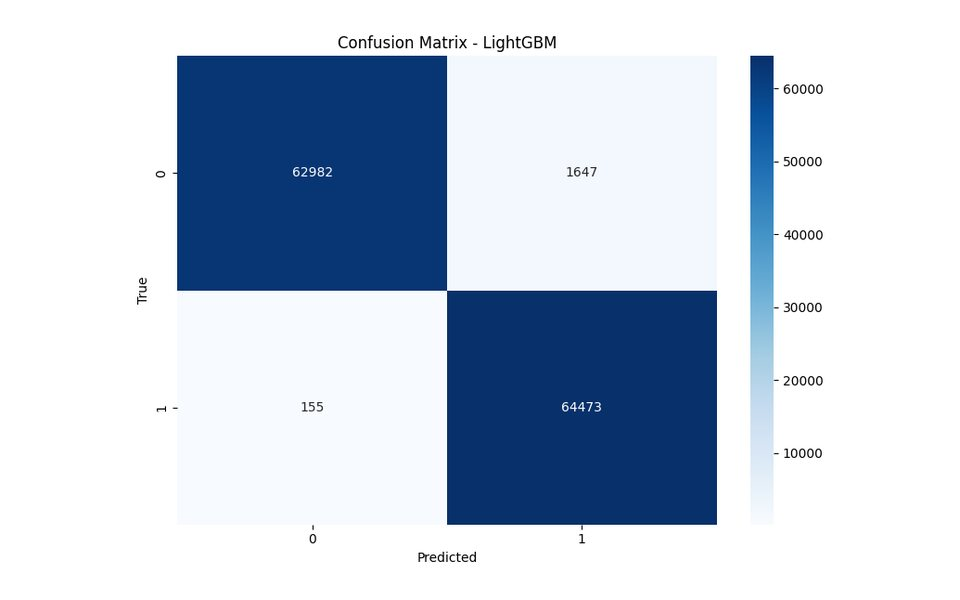

# Network traffic analyser

A Flask web app for network teams. Upload a packet capture exported from Wireshark as CSV; the app rebuilds the traffic flows, labels each one benign or malicious with a LightGBM model, and charts what it found. A report can be downloaded afterwards.



## How it works

1. **Flow reconstruction.** Packets from the Wireshark CSV are grouped into flows and the flow statistics are computed the way CICFlowMeter does. A CSV that already contains flow features is accepted as well.
2. **Features.** Eight packet-size features, chosen by mutual information: average packet size, packet length mean / min / max, average forward segment size, and forward packet length mean / min / total.
3. **Classification.** A standard scaler followed by LightGBM returns benign or malicious, with a probability, for every flow.
4. **Reporting.** Counts, charts and a per-flow table in the browser, plus a downloadable report.

## Model

Trained on CIC-DDoS2019 (431,371 flows across the attack types, labelled benign or attack). Classes were balanced with SMOTE to 646,284 flows, then split 80 / 20.

| Model | Accuracy | Precision | Recall | F1 | ROC-AUC |
| --- | --- | --- | --- | --- | --- |
| **LightGBM** | 0.9861 | 0.9863 | 0.9861 | 0.9861 | 0.9971 |
| Stacking | 0.9860 | 0.9863 | 0.9860 | 0.9860 | 0.9971 |
| CatBoost | 0.9859 | 0.9862 | 0.9859 | 0.9859 | 0.9971 |

Measured on 129,257 test flows. LightGBM was kept because it matched the stacked model at a fraction of the cost.

## Run it

```bash
python -m venv .venv
.venv\Scripts\activate          # Windows; use `source .venv/bin/activate` on Linux or macOS
pip install -r requirements.txt
python app.py
```

Open http://localhost:5000 and upload a CSV. To try it without a capture, run `python generate_sample_data.py`; it writes sample files with the eight features into `data/`.

Endpoints: `/` (interface), `/analyze` (upload), `/download-report`, `/calibrate`, `/health`.

The server binds to 127.0.0.1. Set `HOST=0.0.0.0` to expose it on your network and `SECRET_KEY` to a fixed value if you need one.

## What is in this repository

| Path | Purpose |
| --- | --- |
| `app.py` | Flask app, flow reconstruction and scoring |
| `templates/index.html` | Interface |
| `model/` | Trained LightGBM model and fitted scaler |
| `train_model.ipynb` | Data preparation, feature selection, training and evaluation |
| `generate_sample_data.py` | Sample traffic generator for testing the app |

The CIC-DDoS2019 dataset is not stored here.

## Limits

- SMOTE and scaling were applied before the train / test split, so synthetic neighbours of training flows are in the test set and the figures above are optimistic. Refit with the split first before quoting them for a real deployment.
- The model has seen DDoS traffic from one lab dataset. It will miss attack types it was not trained on, and traffic from a different network should be validated before the output is trusted.
- Uploads are processed on the machine that runs the app. Do not expose it to the internet without authentication.

## Author

Muhammad Umer Khan, [Neurals Solutions](https://neuralssolutions.com)

## License

MIT. See [LICENSE](LICENSE).
